# tripwire

Plants fake but believable files (a passwords spreadsheet, a `.env`, an `id_rsa`, a `wallet.dat`, ...) in folders on your own machine and tells you when something touches them. Nothing legitimate has a reason to open `passwords.xlsx` in your Documents folder, so any access is worth a look.

Node 22.5+ (developed on 26), no dependencies. Registry is a SQLite file written with `node:sqlite`.



The picture is drawn by the UI's own script against synthetic data and exported as SVG; it is not a browser capture.

## Use

```
node bin/tripwire.js plant C:\Users\me\Documents\Finance
node bin/tripwire.js plant D:\old --only env,ssh,wallet
node bin/tripwire.js status
node bin/tripwire.js watch --interval 5
node bin/tripwire.js ui
node bin/tripwire.js remove C:\Users\me\Documents\Finance --dry-run
```

`plant` makes passwords.xlsx, passwords.txt, logins.docx, backup_keys.zip, .env, id_rsa and wallet.dat. The xlsx, docx and zip are written by a small stored-only zip writer in `src/zip.js`, so they open in Office and 7-Zip. Each file carries a random token (inside a password cell, the fake AWS key id, the base64 key body, the wallet header), and its hash is stored in the registry. Existing files are never overwritten. The ssh key body says it is fake and is not a valid key; the AWS and Stripe values are random.

The registry and `alerts.log` (one JSON object per line) live in `%LOCALAPPDATA%\tripwire`; override with `--home <dir>` or `TRIPWIRE_HOME`.

## How access is detected

- `check` / `watch` compare each decoy's mtime and atime to the stored baseline, plus deletion. `watch` also runs `fs.watch` on the decoy folders for quicker reaction. `check` exits 2 if anything tripped, so it can run from Task Scheduler.
- `--audit` (Windows) reads Security event 4663 for the decoy paths. This only works if you have turned on file auditing yourself; `tripwire audit-help` prints the `auditpol` and SACL commands for your decoys and tripwire never runs them. Reading the Security log needs an elevated prompt.
- `--who` runs a short PowerShell snippet when an alert fires and records a guess: the foreground process plus processes started in the last two minutes. It is a guess, not an owner of the handle. Without `--who` the process is left empty, except for 4663 events, which carry the process name.

Alerts go to the console, the registry and `alerts.log`. `--webhook <url>` additionally POSTs JSON (`text`, `content` and the alert) to that URL; it is off unless you pass it.

atime is the weak spot. NTFS has last-access updates switched off or delayed on many Windows setups (`fsutil behavior query disablelastaccess`), so a plain read may not change it. Modification, rename-over and deletion are caught reliably; reads are best caught with auditing. Antivirus and indexers also touch files and can produce alerts.

## remove

`remove [dir]` deletes a decoy only if its current SHA-256 matches what was written. A file you have since replaced is reported as `refused` and left alone (exit code 3); `--forget` drops it from the registry without touching the file. Files already gone are just forgotten. `--dry-run` shows what would happen.

## ui

`tripwire ui` serves on 127.0.0.1 (default port 7733), rejects requests whose Host is not the loopback address and port or whose Origin does not match on non-GET requests, and prints the URL. `--no-open` skips launching a browser; `--browser <exe>` or `BROWSER` picks one. It takes the same options as `watch`, so it also monitors while open.

Decoys are nodes on a spider web. A new alert sets the strands around that node vibrating and adds a "vibration" entry to the timeline; nodes touched in the last ten minutes stay red. Only file and folder names are sent to the page, not full paths. The page is plain SVG and inline script, no external requests.

## Tests

```
node --test "test/*.test.js"
```

Temp-dir tests cover planting, the archive formats, simulated access and deletion, 4663 parsing, safe removal (including a file swapped for a foreign one), bad CLI input, a corrupt and a wrong-schema registry, the webhook and the UI server's Host/Origin checks.

## Gaps

- The monitor needs to be running to notice; changes made while it was off show up on the next `check` only as an mtime/atime difference.
- With many decoys (about 20+) the web gets crowded and labels can overlap.
- The `--who` guess and the 4663 path were not exercised against a live Windows audit setup here, only against parsed sample events.
- Only tested on Windows with Node 26.
